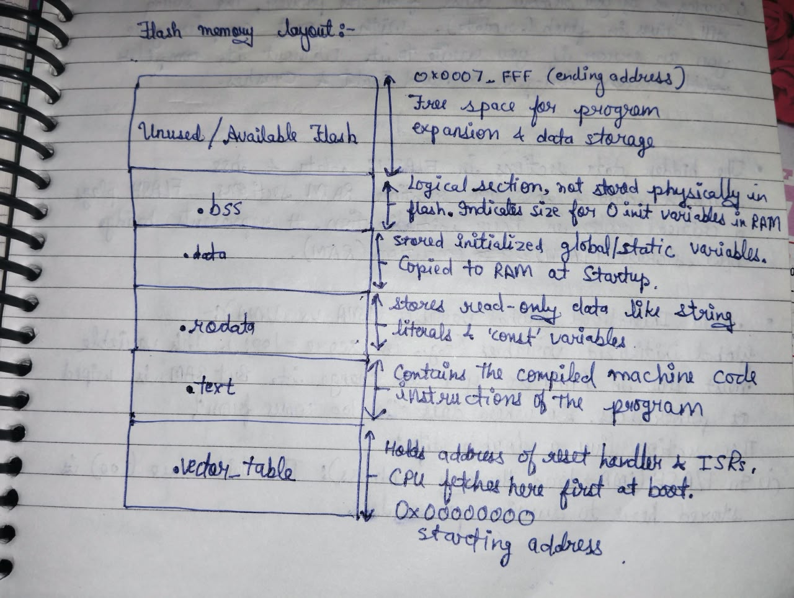
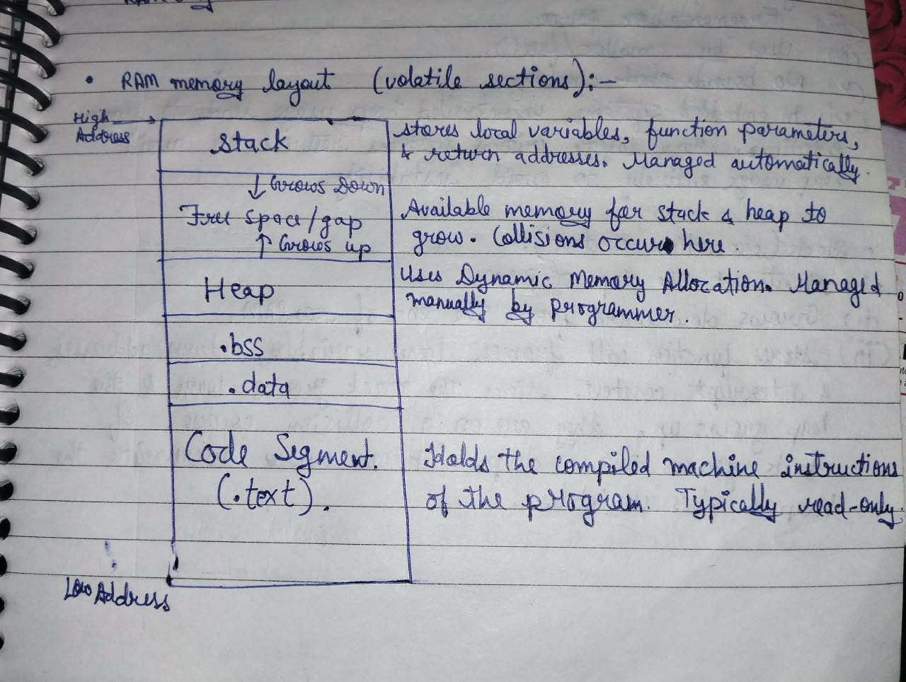

## STM32 Bare-Metal Firmware Repository
This repository is for STM32 F446RE, built using custom MakeFile, LinkerScript, StartupCode and Drivers. 

The goal while making this repository was to understand the whole building and flashing of C code into STM32, how a piece of code works with the hardware and what happens behind all those abstractions of an IDE.

## Why I Made This?
I started working on this repository to understand things behind all those abstractions, as I always used to wonder what these files even do, and how does clicking this one button can debug or compile or run my code on my MCU and how can these multiple files and folders are managed.

Some of my goals were:
- Understand what happens before a C program starts executing.
- Learn the build and flashing process.
- Understand what happens when I click the Build, Debug or Run buttons in STM32CubeIDE.
- Learn how a microcontroller's memory is organized and how the linker uses that memory.
- Understand the role of startup code, vector tables and linker scripts.
- Learn how to configure and use the GNU Arm Embedded Toolchain.
- Understand compiler and linker flags and how they affect the generated firmware.
- Write and debug firmware without depending on STM32CubeIDE or STM32 HAL.
- Build a better understanding of ARM Cortex-M architecture and low level embedded programming.
- And of course, for fun!

## Tools and Technologies
- gcc-arm-none-eabi toolchain
- GNU Debugger (GDB)
- Open On Chip Debugger (OpenOCD)
- GNU Linker Script
- GNU Make
- Git
- C Programming
- STM32 NUCLEO F446RE

## Project Structure
```
stm32-baremetal/
│
├── includes/          # Header files
├── src/               # Source files
├── obj/               # Intermediate object files
├── build/             # Generated firmware files
│
├── Makefile           # Build automation
├── linkerScript.ld    # Memory layout
├── main.map           # Map file 
│
└── README.md
```
## Build Process

### 1. Process Of Converting High Level 'C' code to machine code
```
.c (source file)
        |
        |
        V
    Preprocessor
        |
        |   (.i file)
        V
      Parser
        |
        |
        V
   Code Generator
        |
        |   (.s file)
        V
    Assembler (converts mnemonics to machine code)
        |
        |
        V
    .o file (processor architecture specific machine codes with no specific values) 
```
- `.i` and `.s` files are not saved by compiler, but we can give commands to save them (-E flag for .i and -S flag for .s file).
- All of this is done by compiler.

### 2. Linking Stage of the build
```
.o (re-locatable obj file)
        |
        |
        V
Linker + .a (other libraries like std and third parties)
        |
        |
        V
.elf (executable and debug file)    
        |
        |
        V
    objcopy tool
     |        |
     |        |
     V        V
   .ihex     .bin
```

## Important Components
### 1. Startup Code (startup.c)
- The startup file is responsible for setting up the right environment for the main user code to run.
- Code written in startup file runs before main(). So you can say startup file calls main.
- Some part of the startup file is target (Processor) dependent (eg. vector table).
- Startup code takes care of vector table placement in code memory as required by the ARM Cortex-Mx processor.
- Startup code also take care of stack reinitialization.
- Startup code is responsible of .data and .bss section initialization in main memory.
- Startup code initializes standard libraries. 
- Before startup code there are few things which happens and which are not in out control:
    `The voltages stabalize -> Clock Signal Synched -> Peripherals and Registers restored to default state`
- `Note:` Generally startup file is written in `assembly` but I wrote it in `C` due to my limited knowledge of assembly.

### 2. Linker Script (linkerScript.ld)
- Linker Script is a text file which explains how different sections of the object files should be merged to create an output file.
- Linker and locator combination assigns unique absolute addresses to different sections of the output file by referring to address information mentioned in the linker script.
- Linker Script also includes the code and data memory address and size information.
- Linker Scripts are written using the GNU Linker Command language.
- You must supply linker script at the linking phase to the linker using `-T` flag. 

### 3. Makefile
The Makefile automates the build process.

It handles:
- Compiling C and assembly source files.
- Generating object files.
- Managing header dependencies.
- Linking object files.
- Generating the ELF executable.
- Generating firmware output files.
- Invoking programming and debugging tools.

### 4. Memory Layout
#### Flash Layout:


#### RAM Layout:


## Learning Outcomes:
- Through this project, I aim to develop a deeper understanding of:
- The embedded C compilation and linking pipeline.
- ARM Cortex-M startup and initialization.
- Memory-mapped peripheral programming.
- Flash and SRAM organization.
- Linker scripts and executable sections.
- GNU Make and build automation.
- Firmware debugging using GDB and OpenOCD.


## Future Improvements:
This repository was primarily created to learn about the concepts behind the curtains of abstractions and there are a lot of things to add in it. This will keep improving as I learn more and more about Embedded Systems and STM32 Programming.

Here are some improvements that I plan to implement:
- Add peripheral drivers.
- Add RCC, DMA and Interrupt options.
- Add sections in README.md: 
    `How to build, flash and debug` & `What happens when you press the Reset Button`
- Improve the debugging part.
- Integrate it with CMSIS.

## Thank You For Reading It Till The End!